# BeautyTime

Plataforma web de agendamento para salões de beleza, barbearias e estúdios.

## 1. Apresentação

**BeautyTime** conecta clientes e salões em um só lugar. O salão cadastra seus serviços, sua equipe e os horários de atendimento, e recebe um link próprio para divulgar. A cliente encontra o salão (pelo link ou pela busca), escolhe o serviço, o profissional e o horário, e acompanha suas reservas.

**Problema que resolve:** hoje muitos salões marcam horários por WhatsApp e telefone. Isso gera conversas longas, horários duplicados, esquecimentos e nenhuma visão do movimento do negócio. O BeautyTime organiza a agenda, mostra só horários realmente livres e dá ao salão um painel com os números da semana.

**Público-alvo:**
- Clientes que querem marcar horário de forma rápida, a qualquer hora.
- Donos de salões, barbearias e estúdios que querem organizar a agenda e acompanhar o negócio.
- A equipe responsável pela plataforma, que acompanha e dá suporte a todos os salões.

## 2. Acesso ao aplicativo

A versão entregue **roda localmente** (não há deploy público). O backend (banco de dados e API) está publicado no **Xano**; o frontend em **Reflex** roda no computador.

### Como rodar (Windows)

Pré-requisitos: Python 3.11+, Node.js e Git instalados.

```powershell
git clone https://github.com/amandaemidio-collab/beautytime-projeto.git
cd beautytime-projeto
python -m venv .venv
.\.venv\Scripts\python.exe -m pip install -r requirements.txt
cd frontend
..\.venv\Scripts\python.exe -m reflex run
```

Quando aparecer `App running at: http://localhost:3000`, abra o endereço no navegador.

### Endereços principais

| Página | Endereço |
|---|---|
| Página inicial | http://localhost:3000/ |
| Encontrar salões | http://localhost:3000/saloes |
| Login / cadastro da cliente | http://localhost:3000/clientes/login · http://localhost:3000/clientes/cadastro |
| Meus agendamentos | http://localhost:3000/meus-agendamentos |
| Página de um salão (link do salão) | http://localhost:3000/agendar/salao-aurora |
| Login / cadastro do dono do salão | http://localhost:3000/admin/login · http://localhost:3000/admin/cadastro |
| Painel do dono do salão | http://localhost:3000/admin |
| Login do administrador da plataforma | http://localhost:3000/platform/login |

> O login do administrador da plataforma não aparece em nenhum menu do app: o acesso é feito diretamente pelo endereço acima.

## 3. Perfis de usuários

| Perfil | Quem é | O que pode fazer | O que não pode fazer |
|---|---|---|---|
| **Cliente** | Pessoa que agenda serviços | Buscar salões, agendar, ver e cancelar as próprias reservas | Ver dados de outros clientes ou painéis administrativos |
| **Dono do salão** (`admin`) | Responsável por um salão | Gerenciar serviços, profissionais, horários e agenda **do próprio salão**; ver o dashboard; copiar o link público | Ver ou alterar dados de outros salões |
| **Administrador da plataforma** (`platform_admin`) | Equipe do BeautyTime | Ver **todos** os salões, buscar e filtrar, ver o dashboard de cada salão e corrigir dados de salões, serviços e profissionais | Não é criado pelo app: a conta é definida diretamente no banco de dados |

Todas as permissões são verificadas no backend (Xano). Esconder um botão na tela não é a única proteção: se alguém tentar acessar um endereço que não é do seu perfil, a API recusa.

## 4. Funcionalidades

**Cliente**
- Buscar salões por nome e filtrar por serviço
- Ver serviços, preços e duração de cada salão
- Agendar escolhendo serviço, profissional (ou "sem preferência"), dia e horário
- Ver agendamentos futuros e passados
- Cancelar agendamento (gratuito com 8 horas ou mais de antecedência)

**Dono do salão**
- Dashboard com agendamentos de hoje e da semana, faturamento estimado, taxa de cancelamento, serviços mais agendados e próximos horários
- Cadastrar, editar, desativar e reativar serviços
- Cadastrar, editar, desativar e reativar profissionais e os serviços que cada um realiza
- Cadastrar os períodos de atendimento semanais de cada profissional
- Consultar a agenda por dia e por profissional
- Copiar o link público do salão para enviar às clientes

**Administrador da plataforma**
- Listar todos os salões, com contagem de serviços, profissionais e agendamentos
- Buscar salões por nome e filtrar por serviço
- Ver o dashboard de qualquer salão
- Editar dados do salão, dos serviços e dos profissionais (toda alteração fica registrada em log)

## 5. Manual de utilização

### 5.1 Jornada da cliente

**Passo 1. Encontrar um salão.** Acesse *Encontrar salões* (`/saloes`). Digite o nome do salão e/ou um serviço (ex.: "corte") e clique em **Buscar**.
*Resultado esperado:* aparecem apenas os salões que atendem ao filtro, com seus serviços ativos, duração e preço.

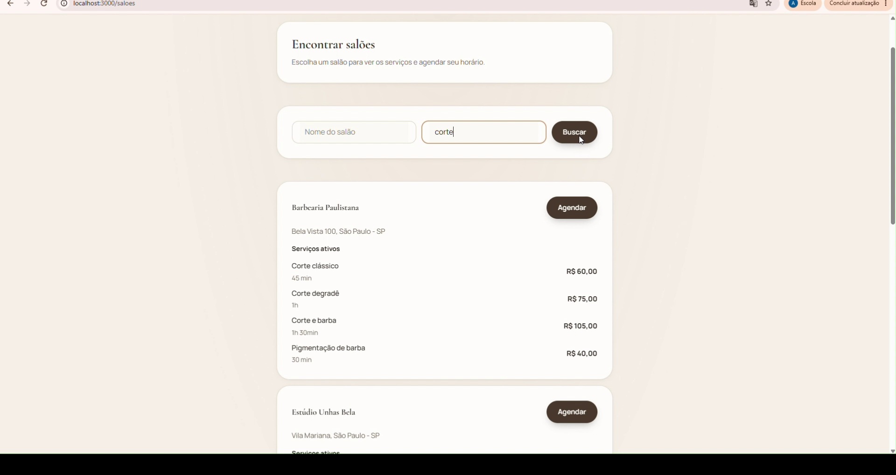

**Passo 2. Escolher serviço, profissional e horário.** Clique em **Agendar** no salão desejado (ou abra o link que o salão enviou). Escolha o serviço, o profissional (ou "Sem preferência"), o dia e um horário disponível. Se ainda não estiver logada, clique em **Entrar para confirmar**.
*Resultado esperado:* só aparecem horários realmente livres para o profissional escolhido. O resumo da reserva aparece em *Confirmação*.

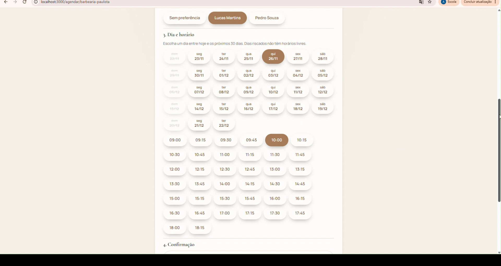

**Passo 3. Confirmar.** Clique em **Confirmar agendamento**.
*Resultado esperado:* aparece a mensagem *Agendamento confirmado* com o resumo (serviço, data, salão, profissional, duração e preço) e a regra de cancelamento.

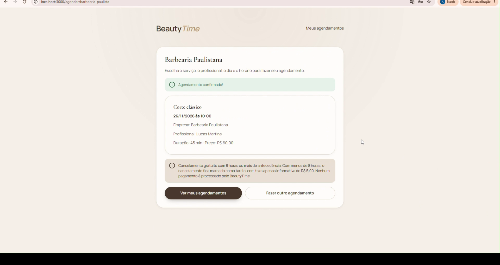

**Passo 4. Acompanhar as reservas.** Acesse *Meus agendamentos* (`/meus-agendamentos`).
*Resultado esperado:* a lista mostra os agendamentos *Próximos* e *Passados*, cada um com o selo de status (Agendado ou Cancelado) e os botões **Agendar de novo** e **Cancelar agendamento**.

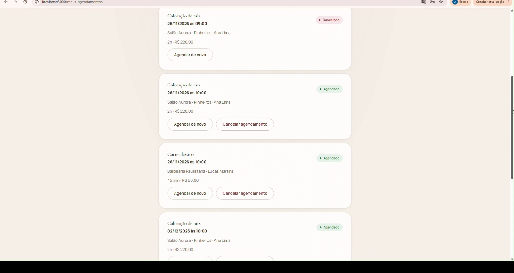

### 5.2 Jornada do dono do salão

**Passo 1. Acompanhar o negócio.** Entre em `/admin/login`. O *Painel administrativo* abre com os números do salão.
*Resultado esperado:* cards com agendamentos de hoje, agendamentos na semana, faturamento estimado da semana (sem contar cancelados) e taxa de cancelamento, além dos serviços mais agendados, dos próximos horários de hoje e do link público com o botão **Copiar link**.

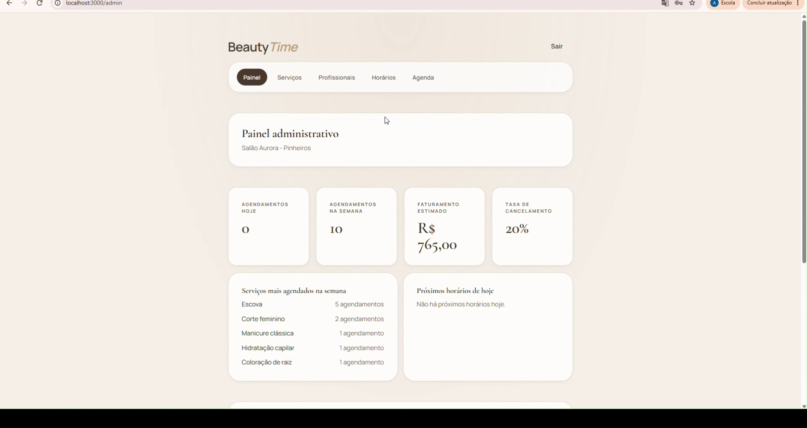

**Passo 2. Cadastrar serviços.** No menu, clique em **Serviços**. Preencha nome, duração e preço e clique em **Cadastrar serviço**. Use **Editar**, **Desativar** ou **Reativar** em cada item do catálogo.
*Resultado esperado:* o serviço aparece no *Catálogo* com o selo *Ativo*. Serviços desativados deixam de aparecer para as clientes, mas os agendamentos antigos são preservados.

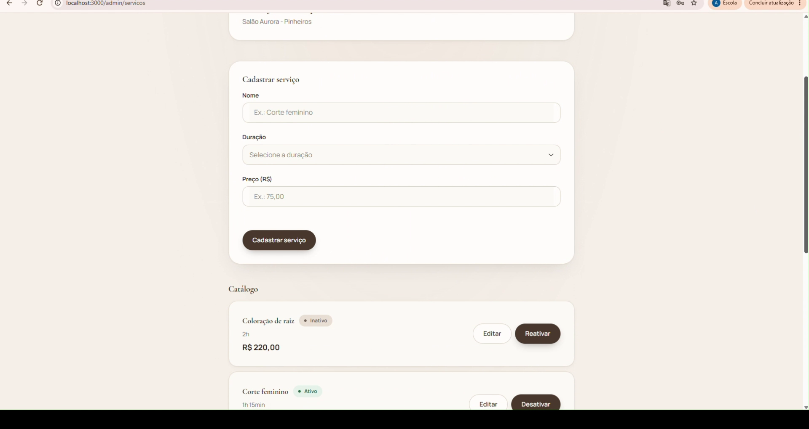

**Passo 3. Cadastrar profissionais e horários.** Em **Profissionais**, cadastre cada pessoa da equipe e marque os serviços que ela realiza. Em **Horários**, escolha o profissional, marque os dias da semana, informe início e término e clique em **Cadastrar período**.
*Resultado esperado:* o profissional passa a aparecer no agendamento das clientes, apenas nos dias e horários cadastrados.

**Passo 4. Consultar a agenda.** Em **Agenda**, escolha o dia e, se quiser, um profissional.
*Resultado esperado:* a lista mostra cada agendamento com serviço, horário de início e término, cliente, profissional e status.

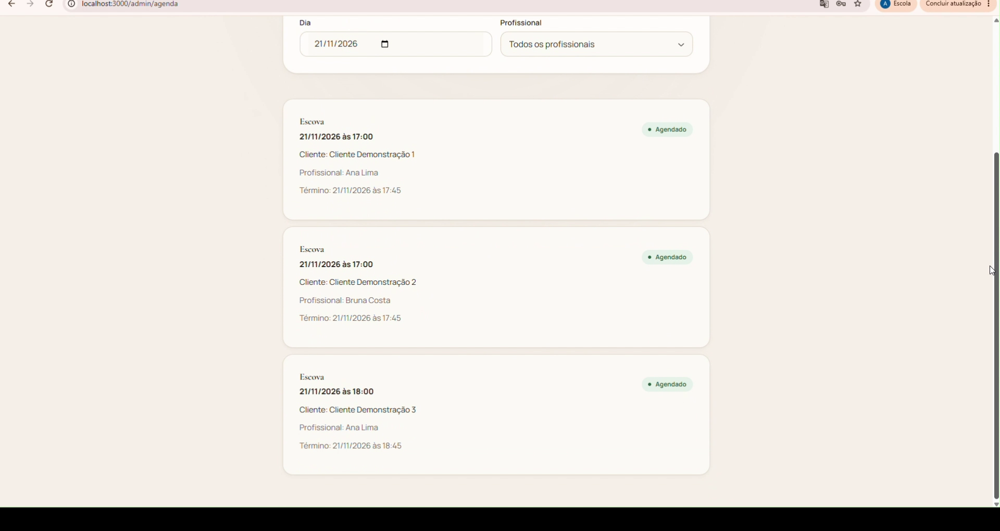

**Passo 5. Divulgar o salão.** No *Painel*, clique em **Copiar link** e envie para as clientes.
*Resultado esperado:* quem abre o link cai direto na página de agendamento do salão.

### 5.3 Jornada do administrador da plataforma

**Passo 1. Ver todos os salões.** Entre em `/platform/login`. Use **Buscar por nome** e **Filtrar por serviço ativo**.
*Resultado esperado:* a lista mostra todos os salões, com a quantidade de serviços, profissionais e agendamentos de cada um.

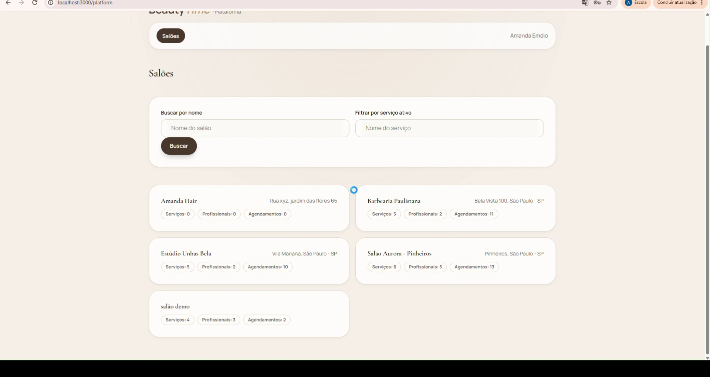

**Passo 2. Acompanhar um salão.** Clique no card de um salão.
*Resultado esperado:* abre o dashboard daquele salão (os mesmos indicadores que o dono vê) e as abas *Dados do salão*, *Serviços* e *Profissionais*.

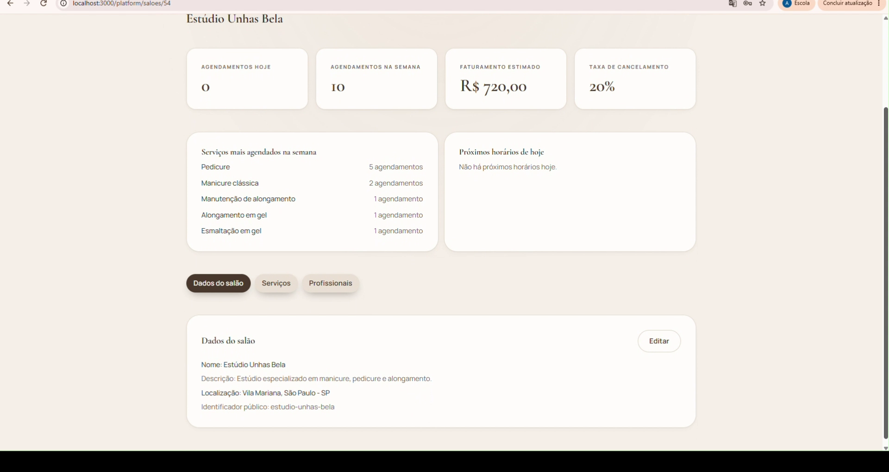

**Passo 3. Corrigir dados.** Em qualquer aba, clique em **Editar**, altere o que precisa (ex.: preço de um serviço) e clique em **Salvar**.
*Resultado esperado:* a alteração é salva e registrada no log de eventos da plataforma.

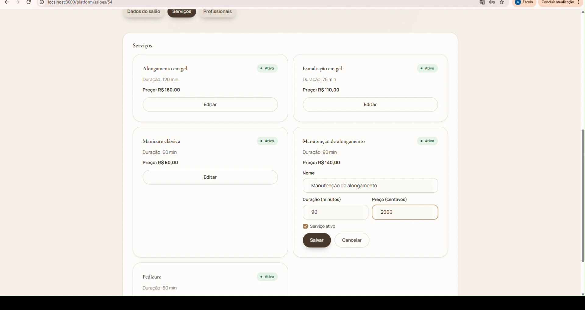

## 6. Situações alternativas e tratamento de erros

**Login com senha errada.** Se o e-mail ou a senha estiverem incorretos, ou se a conta não for do tipo daquela tela, o acesso é recusado com uma mensagem clara.

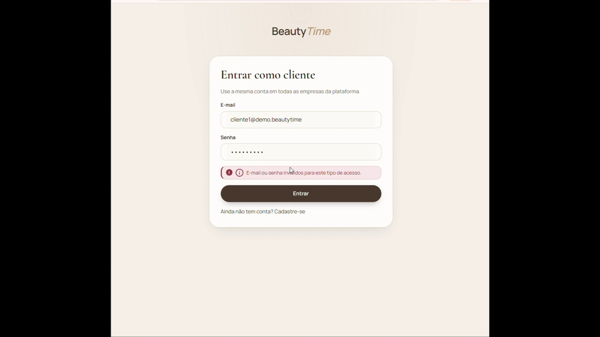

**Cancelamento com confirmação.** Ao clicar em **Cancelar agendamento**, o app pede confirmação e informa se o cancelamento é gratuito (8 horas ou mais de antecedência) ou tardio (menos de 8 horas, com taxa apenas informativa de R$ 5,00; nenhum pagamento é processado).

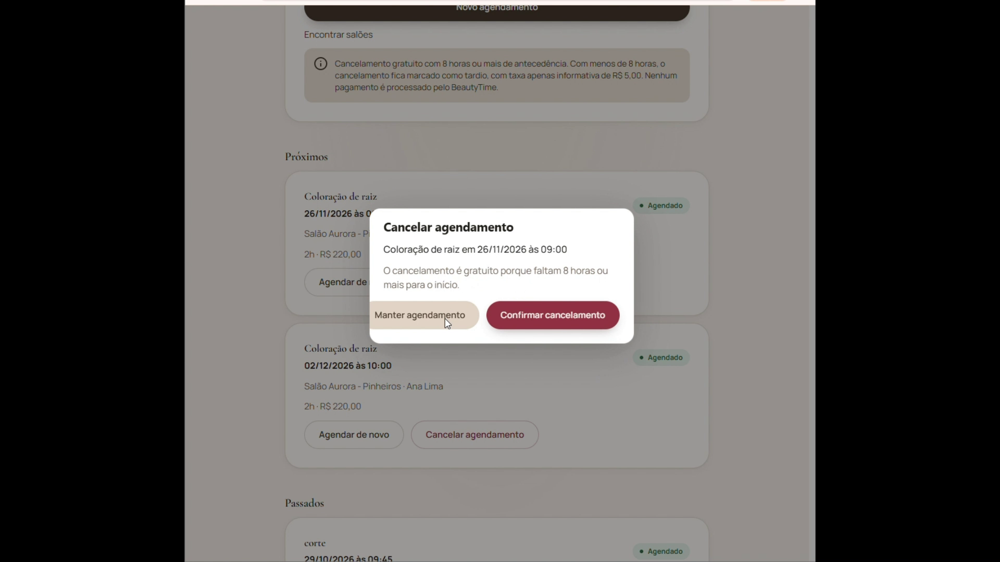

*Resultado esperado:* aparece a mensagem *Agendamento cancelado sem taxa* e o selo muda para *Cancelado*. O horário volta a ficar livre.

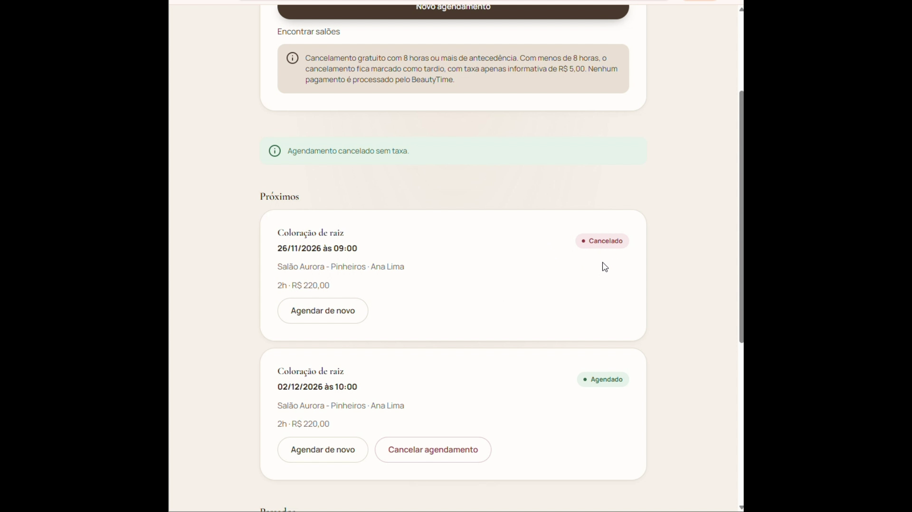

**Serviço com nome repetido.** O salão não pode ter dois serviços com o mesmo nome. O formulário avisa e não cadastra.

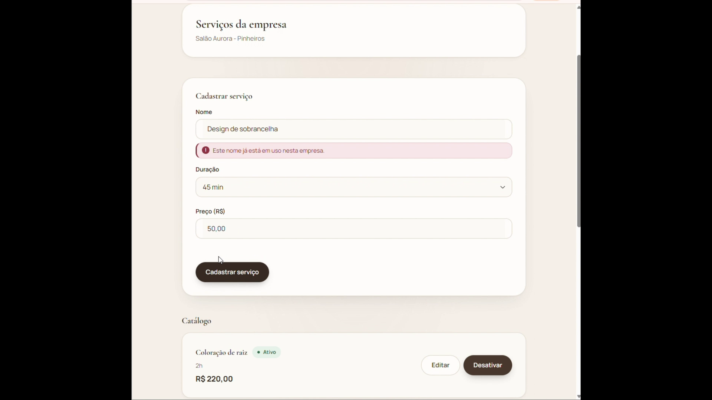

**Agenda sem reservas.** Quando não há agendamentos para o dia ou o profissional escolhido, a tela explica e sugere trocar o filtro.

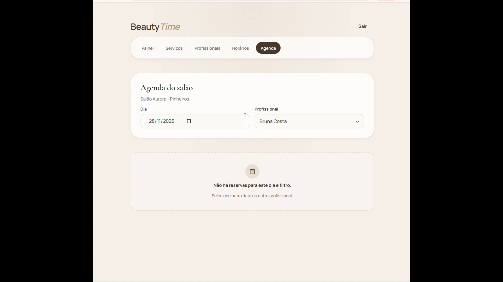

**Cliente sem agendamentos.** Uma conta nova vê uma orientação para usar **Novo agendamento** e encontrar um salão.

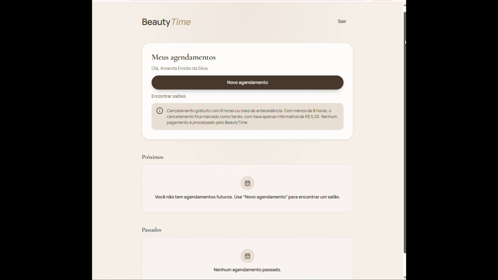

**Profissional sem horários.** Se um profissional ainda não tem períodos de atendimento, a tela avisa. Enquanto isso, ele não aparece com horários disponíveis para as clientes.

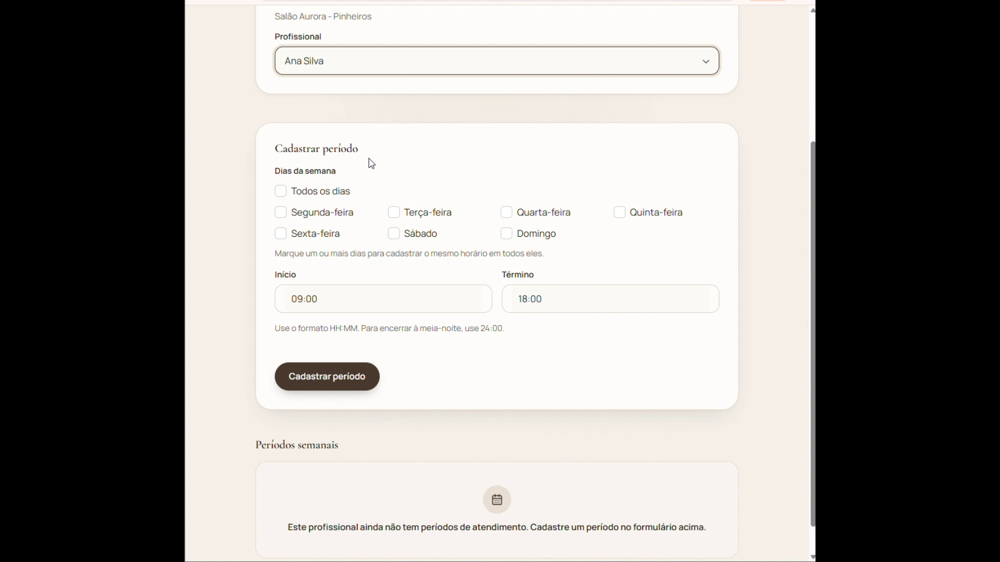

**Outras proteções:**
- Abrir `/platform` sem estar logado como administrador da plataforma leva de volta ao login.
- O dono de um salão nunca vê os dados de outro salão: o salão é identificado pelo login, e não por um parâmetro enviado pela tela.
- Só aparecem na busca os salões que realmente aceitam agendamento (com serviço ativo e profissional ativo).

## 7. Exemplos de utilização (dados de demonstração)

O banco tem dados de demonstração para testar todas as jornadas. **Senha de todas as contas: `Demo@2026`**

| Perfil | E-mail | Link do salão |
|---|---|---|
| Dono: Salão Aurora - Pinheiros | dono.salao-aurora@demo.beautytime | http://localhost:3000/agendar/salao-aurora |
| Dono: Barbearia Paulista | dono.barbearia-paulista@demo.beautytime | http://localhost:3000/agendar/barbearia-paulista |
| Dono: Estúdio Unhas Bela | dono.estudio-unhas-bela@demo.beautytime | http://localhost:3000/agendar/estudio-unhas-bela |
| Clientes | cliente1@demo.beautytime até cliente4@demo.beautytime | — |

**Cenário sugerido:**
1. Entre como `cliente1@demo.beautytime`, busque "corte" em `/saloes` e agende um horário no Salão Aurora.
2. Entre como `dono.salao-aurora@demo.beautytime` e veja o agendamento novo em **Agenda** e nos números do **Painel**.
3. Volte como cliente e cancele o agendamento: o selo muda para *Cancelado* e a taxa de cancelamento do salão é atualizada.

Os dados de demonstração são gerados pela função Xano `seed_demo_data`, que pode ser rodada novamente sem duplicar registros.

## 8. Limitações conhecidas e próximos passos

**Limitações da versão entregue**
- Não há deploy público: o frontend roda localmente.
- A conta de administrador da plataforma é criada diretamente no banco (não existe tela de cadastro para esse perfil, por segurança).
- Os agendamentos de demonstração foram gerados para uma semana específica; em outras semanas, os números do dashboard podem aparecer zerados até que novos agendamentos sejam feitos.
- O faturamento do dashboard é uma **estimativa** baseada nos preços dos agendamentos; não há pagamento online.
- A taxa de cancelamento tardio é apenas informativa.

**Próximos passos (V2)**
- Publicar o app na internet (deploy)
- Logo e cor personalizadas por salão na página de agendamento
- Central de chamados de suporte para clientes e salões
- Notificações e lembretes de agendamento (e-mail/WhatsApp)
- Pagamento online e sinal de reserva

## 9. Tecnologias

- **Xano**: banco de dados, API e regras de negócio (XanoScript)
- **Reflex** (Python): interface web
- **OpenSpec**: especificação e controle das mudanças (changes)
- **GitHub Copilot** e **Git/GitHub**: desenvolvimento e versionamento
